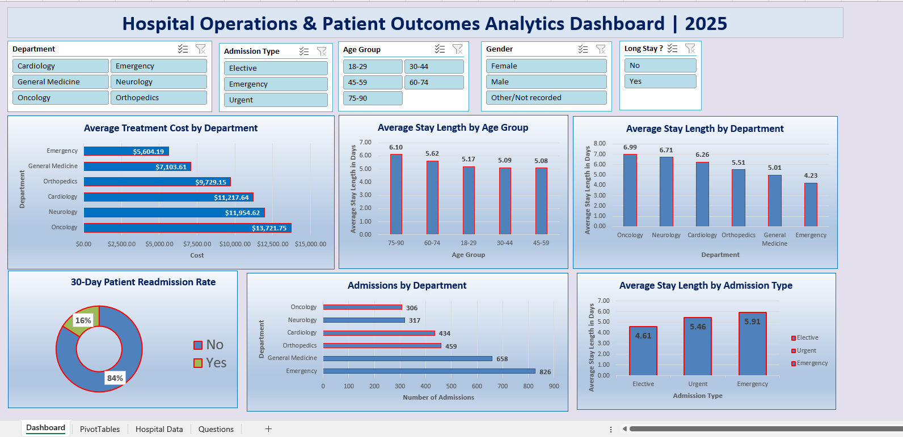
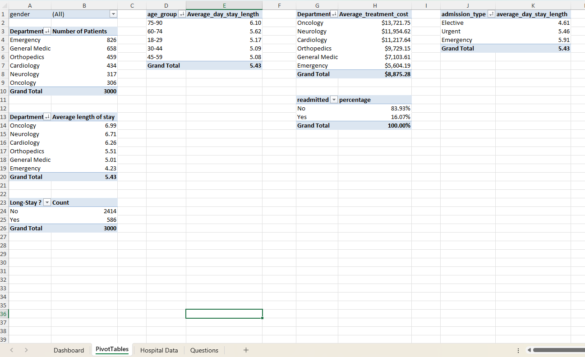
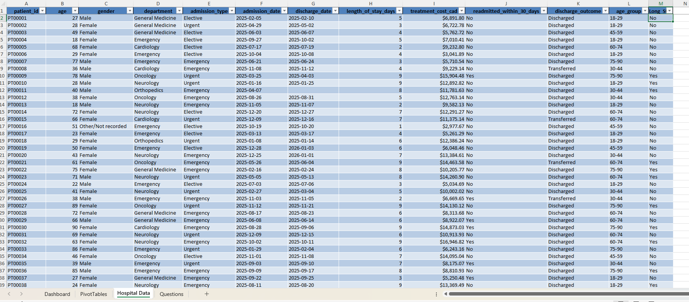
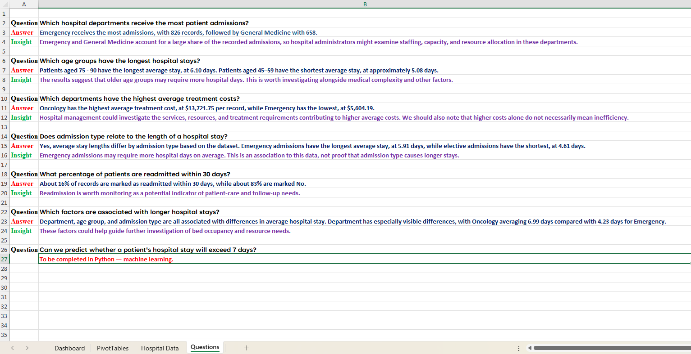
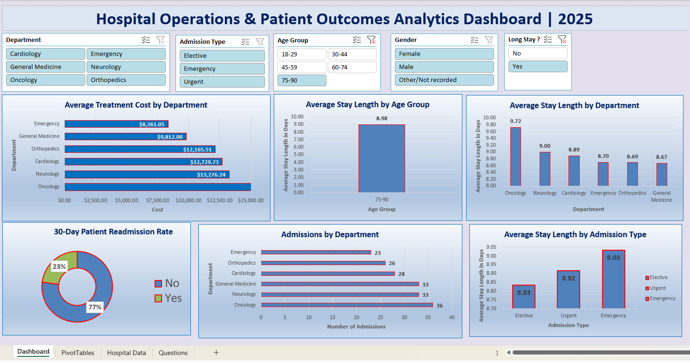
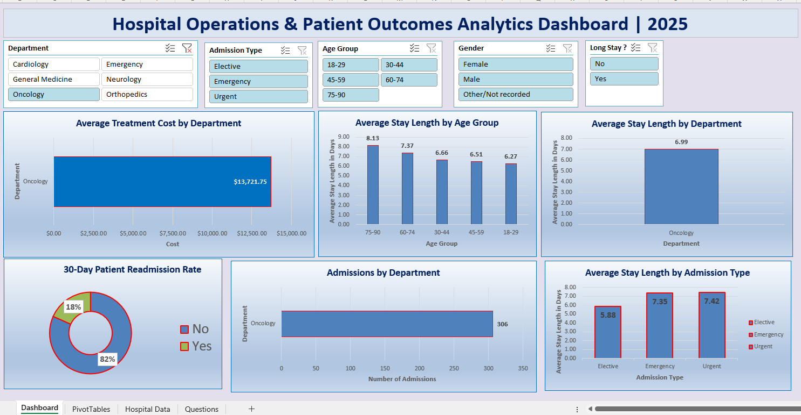

# Hospital Operations & Patient Outcomes Analysis

## Project Overview

This project uses Microsoft Excel to analyze hospital admissions, length of stay, treatment costs, and 30-day readmissions using synthetic healthcare data.

The goal is to identify operational patterns, compare hospital departments, and explore factors associated with patient outcomes.

## Tools Used

- Microsoft Excel
- PivotTables
- PivotCharts
- Slicers
- Data cleaning and analysis

## Dataset

The dataset contains 3,000 synthetic hospital admission records.

It includes the following fields:

- Patient ID
- Age
- Gender
- Department
- Admission Type
- Admission Date
- Discharge Date
- Length of Stay (Days)
- Treatment Cost (CAD)
- Readmitted Within 30 Days
- Discharge Outcome

**Note:** This dataset is simulated. It does not contain real patient records or represent actual clinical outcomes.

## Business Questions

1. Which hospital departments have the highest number of admissions?
2. How does average length of stay vary across age groups?
3. Which departments have the highest average treatment costs?
4. What proportion of patients are readmitted within 30 days?
5. Which departments have the longest average patient stays?
6. How does admission type relate to average length of stay?
7. Can we predict whether a patient will have a long hospital stay using Python and machine learning?

## Key Findings

- **Admissions:** Emergency had the highest number of admissions, with 826 records.
- **Length of stay by age:** Patients aged 75–90 had the longest average stay, at approximately 6.10 days.
- **Treatment costs:** Oncology had the highest average treatment cost, at approximately $13,721.75 CAD.
- **30-day readmissions:** Approximately 16.07% of records were marked as readmitted within 30 days.
- **Length of stay by department:** Oncology had the longest average stay, at approximately 6.99 days.
- **Admission type:** Emergency admissions had the longest average stay by admission type, at approximately 5.91 days.

These findings describe patterns in the synthetic dataset and should not be interpreted as evidence about real hospitals or patients.

## Excel Dashboard

The interactive dashboard contains six visualizations:

1. Admissions by Department
2. Average Stay Length by Age Group
3. Average Treatment Cost by Department
4. 30-Day Readmissions
5. Average Stay Length by Department
6. Average Stay Length by Admission Type

Slicers allow users to filter the dashboard by department, admission type, age group, gender, and long-stay status.

## Project Screenshots

### 1. Interactive Dashboard

### 2. PivotTables

### 3. Sample Dataset

### 4. Business Questions and Answers

### 5. Dashboard Filter 1

### 6. Dashboard Filter 2

## Future Work: Python and Machine Learning (Question 7)

The next phase will use Python to investigate (Answer qn 7) whether a patient is likely to have a long hospital stay. The target variable will be defined as whether the length of stay exceeds seven days. To prevent data leakage, the model will exclude variables that directly reveal the target, including length of stay itself.
